

  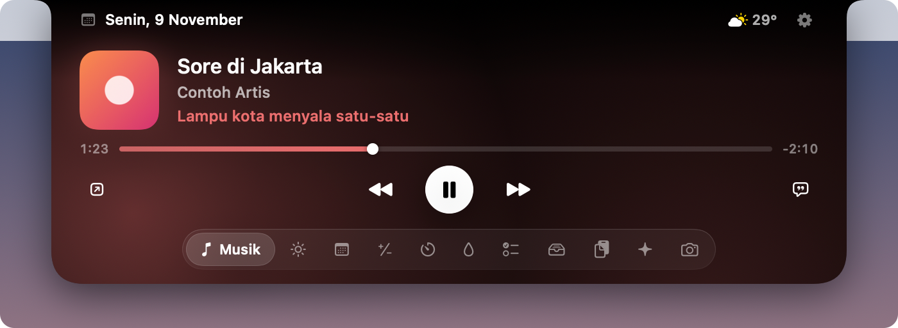

<h1 align="center">Ziland</h1>

  <b>Notch di Mac Anda selama ini hanya diam. Ziland memberinya pekerjaan.</b>

  <a href="https://github.com/zikrimuhammad09/ziland-releases/releases/latest"><b>Unduh Ziland</b></a>
  &nbsp;·&nbsp; macOS 14 atau lebih baru &nbsp;·&nbsp; Apple Silicon &nbsp;·&nbsp; Bahasa Indonesia &amp; English

 

Di sekitar kamera MacBook ada sepotong layar hitam yang tidak pernah dipakai apa pun. Ziland menjadikannya pulau kecil yang hidup: melebar saat ada yang perlu Anda ketahui, terbuka saat kursor diarahkan ke sana, lalu menyatu kembali dengan bezel begitu urusannya selesai.

Tidak ada jendela baru, ikon Dock, atau notifikasi yang menumpuk di pojok layar. Semuanya terjadi di satu tempat yang memang sudah ada di depan mata Anda.

## Hadir sebentar, lalu menghilang

  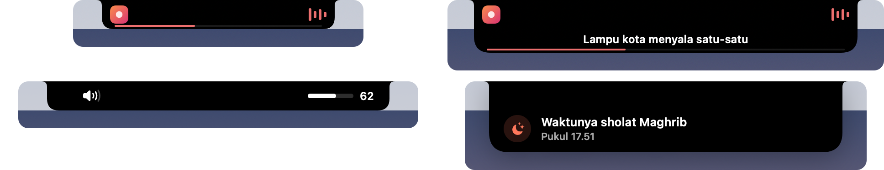

Saat lagu diputar, sampulnya muncul di sisi kiri notch dan equalizer di sisi kanan. Lirik bisa ikut berjalan baris demi baris. Sepuluh menit sebelum waktu sholat, hitung mundurnya mengambil tempat itu. Volume, AirPods yang baru tersambung, charger yang dicabut, hujan yang akan turun dalam satu jam: semuanya lewat sejenak, lalu pulau kembali tenang.

## Sebelas menu dalam satu pulau

Arahkan kursor ke notch dan pulau terbuka. Geser dua jari untuk berpindah menu. Ukurannya menyesuaikan isi, jadi kalkulator tidak tampil di kotak sebesar kalender.

<table>
  <tr>
    <td width="50%">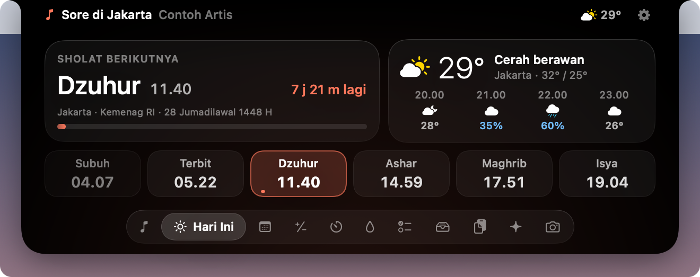 <b>Hari Ini</b> Sholat berikutnya dengan hitung mundurnya, jadwal sehari penuh, dan cuaca empat jam ke depan.</td>
    <td width="50%">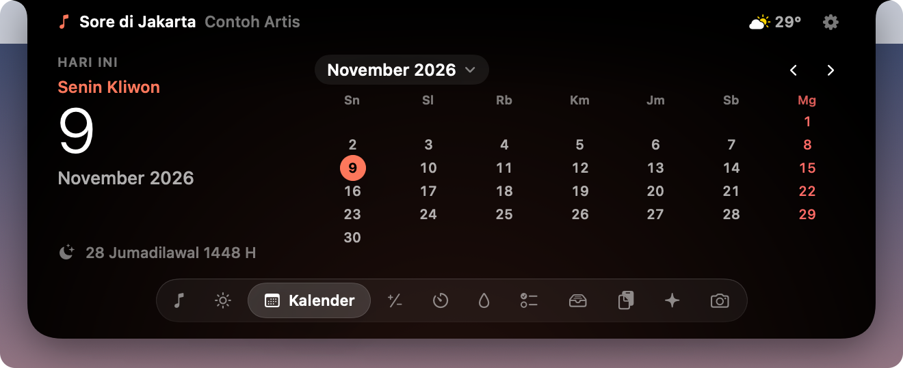 <b>Kalender</b> Libur nasional dan cuti bersama, weton, tanggal Hijriah, serta acara dari app Kalender lengkap dengan tombol Gabung rapat.</td>
  </tr>
  <tr>
    <td>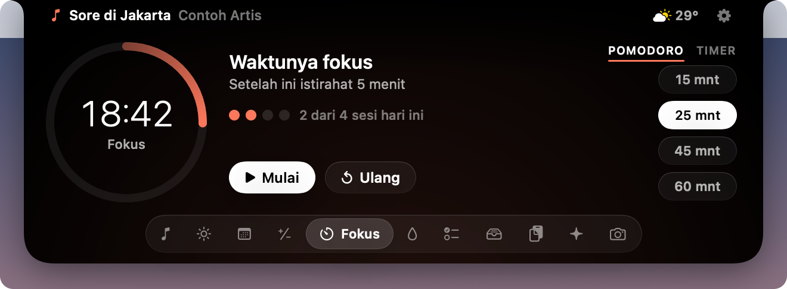 <b>Fokus</b> Pomodoro dengan target harian. Bisa menyalakan Jangan Ganggu selama sesi berjalan.</td>
    <td>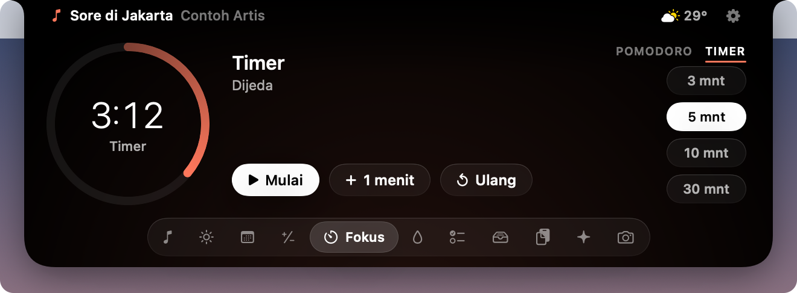 <b>Timer</b> Hitung mundur sederhana untuk teh, jeda, atau presentasi. Tambah satu menit kapan saja.</td>
  </tr>
  <tr>
    <td>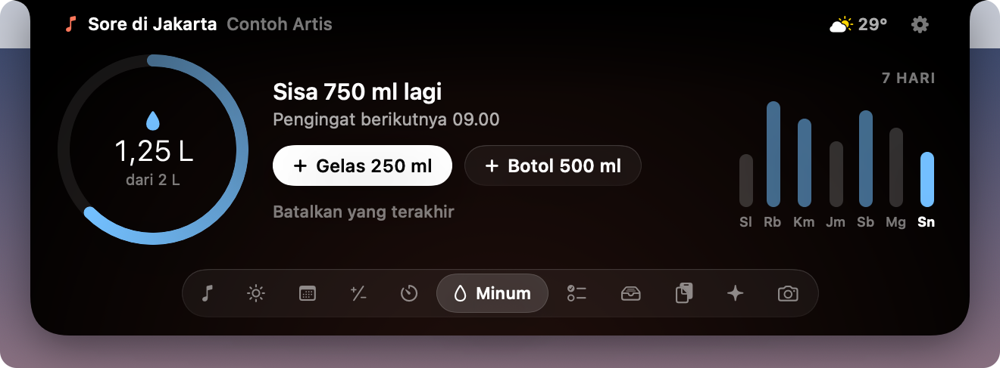 <b>Minum</b> Target harian, grafik tujuh hari, dan pengingat yang hanya muncul di jam aktif.</td>
    <td>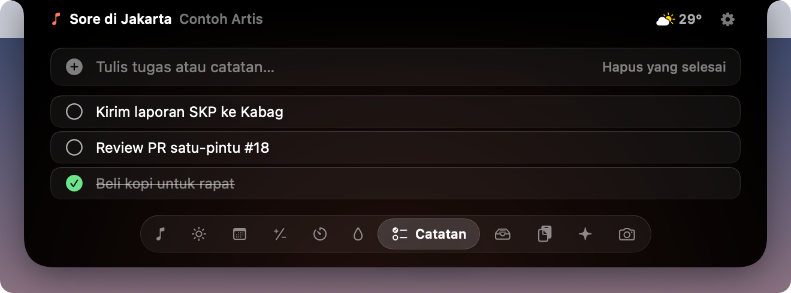 <b>Catatan</b> Tugas singkat yang diketik langsung di pulau. Klik sekali, ketik, tekan Return.</td>
  </tr>
  <tr>
    <td>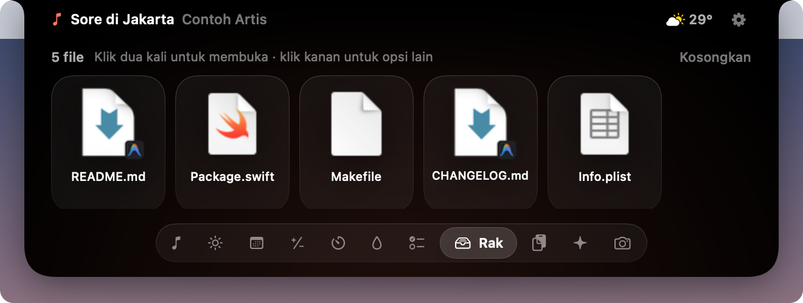 <b>Rak</b> Seret berkas ke notch untuk disimpan sementara, lalu seret keluar ke app lain saat dibutuhkan.</td>
    <td>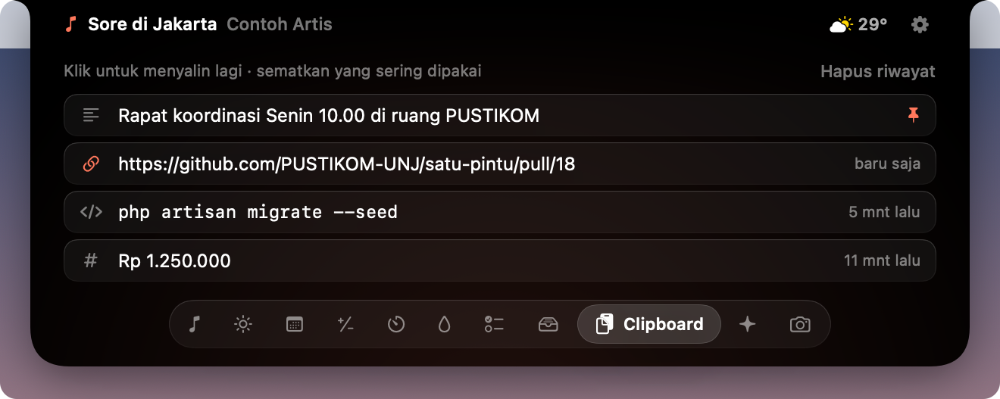 <b>Clipboard</b> Teks yang baru disalin, dengan ikon tautan, kode, atau angka. Isi dari password manager tidak pernah disimpan.</td>
  </tr>
  <tr>
    <td>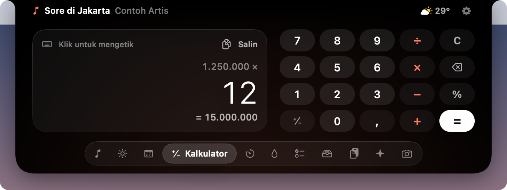 <b>Kalkulator</b> Urutan operasi yang benar, format angka Indonesia, dan bisa diketik dengan keyboard.</td>
    <td>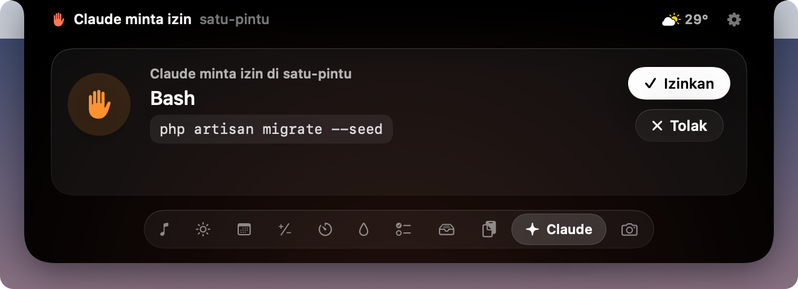 <b>Claude</b> Status sesi Claude Code, dan jawab permintaan izinnya tanpa membuka Terminal.</td>
  </tr>
</table>

Ada juga **Musik** untuk semua pemutar (termasuk YouTube Music di browser) dan **Cermin**, kamera yang hanya menyala selama menunya terbuka, untuk memeriksa penampilan sebelum rapat.

## Dibuat untuk ritme hari di Indonesia

  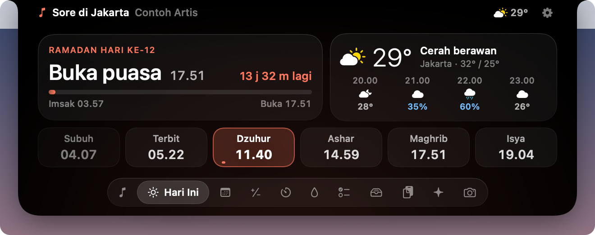

Jadwal sholat dihitung langsung di Mac dengan kriteria **Kemenag RI**, termasuk ihtiyatnya. Hasilnya dicocokkan dengan jadwal resmi Kemenag untuk Jakarta dan selisihnya paling banyak satu menit. JAKIM, MUIS, Umm al-Qura, dan metode lain juga tersedia.

Kalender memuat **libur nasional dan cuti bersama** sesuai SKB 3 Menteri, menampilkan **weton** di setiap tanggal, dan tanggal Hijriah yang bisa digeser mengikuti hasil sidang isbat. Selama **Ramadan**, pulau menghitung mundur waktu berbuka dan Imsak, serta mengingatkan sahur.

Adzan diputar dari berkas pilihan Anda sendiri dan otomatis diam saat mikrofon sedang dipakai rapat. Untuk menghentikannya, cukup arahkan kursor ke notch.

## Tampilan yang bisa Anda miliki

  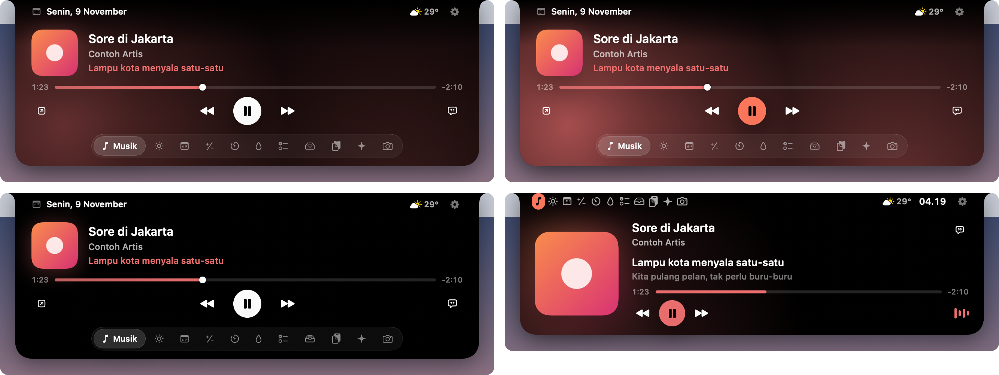

Empat tema dengan karakter berbeda. **Lumen** monokrom dengan cahaya lembut dari sampul lagu. **Aurora** lebih berani dengan cahaya warna aksen. **Onyx** hitam pekat untuk yang ingin pulaunya paling tenang. **Vivid** memindahkan menu ke atas dengan tombol berwarna penuh.

  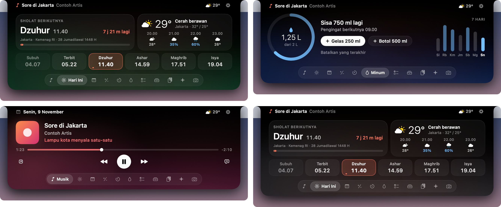

Lalu pilih **nuansa** untuk latar pulau (Malam, Hutan, Lautan, Senja, atau Grafit) dan satu dari tiga belas **warna aksen**, dari Jingga sampai Toska. Bagian di bawah kamera selalu tetap hitam, jadi pulau tetap menyatu dengan notch apa pun pilihannya.

## Ringan, dan tahu batas

Saat diam, Ziland memakai **0,0% CPU** dan sekitar **19 MB** memori. Saat terbuka, sekitar 0,1%.

Satu-satunya data yang keluar dari Mac adalah koordinat kota yang dibulatkan sekitar satu kilometer (ke Open-Meteo, untuk cuaca) dan judul lagu (ke LRCLIB, untuk lirik). Tidak ada akun, analitik, atau pelacakan. Riwayat clipboard hanya ada di memori. Integrasi Claude Code hanya mendengarkan di `127.0.0.1` dan menolak permintaan yang tidak membawa token rahasia milik Mac Anda.

Pembaruan dikirim lewat [Sparkle](https://sparkle-project.org), dan setiap berkas diverifikasi dengan tanda tangan digital sebelum dipasang.

## Memasang

1. Unduh **Ziland-&lt;versi&gt;.dmg** dari halaman [Releases](https://github.com/zikrimuhammad09/ziland-releases/releases/latest).
2. Buka berkasnya, lalu seret **Ziland** ke folder **Applications**.
3. Saat pertama kali dibuka, klik kanan Ziland lalu pilih **Buka**.

Langkah ketiga diperlukan karena Ziland belum dinotarisasi Apple. Jika macOS tetap menolak, buka **Pengaturan Sistem › Privasi & Keamanan** dan klik **Tetap Buka**. Ini hanya perlu dilakukan sekali; setelahnya Ziland terbuka seperti app biasa dan memperbarui dirinya sendiri.

Panduan singkat muncul saat pertama kali dibuka untuk memilih kota, tema, dan izin yang Anda perlukan. Semua izin bersifat opsional.

## Pertanyaan yang sering muncul

**Bagaimana dengan Mac atau monitor tanpa notch?**
Ziland menggambar notch virtual di tengah menu bar. Di monitor eksternal, pulau bisa mengikuti layar yang sedang Anda pakai.

**Apakah tersedia dalam bahasa Inggris?**
Ya. Pilih bahasa di Pengaturan › Umum. Bawaannya Bahasa Indonesia, apa pun bahasa macOS Anda.

**Mengapa Ziland meminta izin Aksesibilitas?**
Hanya jika Anda ingin HUD volume Ziland menggantikan HUD bawaan macOS. Tanpa izin itu, semua fitur lain tetap berjalan.

**Apakah kode sumbernya tersedia?**
Tidak. Repositori ini hanya berisi berkas rilis dan feed pembaruan.

 

---

 

**Ziland in English.** The black strip around your MacBook's camera has never done anything. Ziland turns it into a small, living island: it widens for what matters (the song playing, a countdown to the next prayer, a volume change), opens when you point at it, and melts back into the bezel when it's done. Eleven menus live inside, from Today and Calendar to Focus, Water, Notes, a file Shelf, Clipboard, a camera Mirror and Claude Code. Prayer times follow Indonesia's Kemenag criteria, the calendar knows Indonesian public holidays, and four themes with five background tones let you make it yours. It idles at 0.0% CPU, sends no analytics, and updates itself with signed releases. Download the DMG from [Releases](https://github.com/zikrimuhammad09/ziland-releases/releases/latest), drag it to Applications, and right-click › Open on first launch. Requires macOS 14+ on Apple Silicon.

 

Ziland dibuat oleh Zikri Muhammad. Hak cipta dilindungi.

